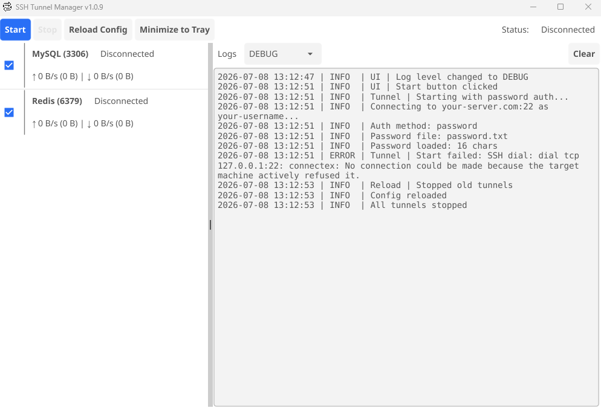

# SSH Tunnel Manager

A GUI-based SSH tunnel manager built with Go and Fyne. Easily manage multiple port forwarding rules with real-time traffic monitoring.

## Features

- **GUI Interface** - Clean, intuitive interface built with Fyne
- **Multiple Tunnels** - Manage multiple SSH port forwards simultaneously
- **Individual Tunnel Control** - Enable/disable tunnels individually with checkboxes
- **Real-time Traffic** - Monitor upload/download rates and total traffic
- **System Tray** - Minimize to system tray with Connect/Disconnect/Quit menu
- **Auto-reconnect** - Keepalive mechanism to maintain connections
- **Password File** - Secure password storage in separate file (git-ignored)
- **Configurable** - YAML-based configuration for easy customization
- **Structured Logs** - Timestamped logs with level indicators (INFO/WARN/ERROR)

## Screenshot



The main interface features:
- **Toolbar** - Start, Stop, Reload Config, and Minimize to Tray buttons
- **Tunnel List** - Each tunnel shows checkbox, name with port, connection status, and traffic stats
- **Log Panel** - Structured logs with timestamp, level (INFO/ERROR), and messages
- **Status Bar** - Shows current connection status (Disconnected/Connected)

## Installation

### Download

Download the latest release from the releases page or build from source.

### Build from Source

```bash
# Clone the repository
git clone <repository-url>
cd go-ssh-tunnel

# Build
.\build.ps1 -Version "v1.0.9"
```

The built executable will be in the `dist/` directory.

## Usage

1. Edit `config.yaml` to configure your SSH server and tunnels
2. Create `password.txt` with your SSH password (or use SSH key)
3. Run `ssh-tunnel.exe`

### Command Line Options

```
ssh-tunnel.exe [options]

Options:
  -config string    Path to config file (default "config.yaml")
  -version          Show version information
```

## Configuration

Edit `config.yaml` to configure your tunnels:

```yaml
ssh:
  host: "your-server.com"
  port: 22
  user: "your-username"
  auth:
    method: "password"           # "password" or "key"
    password_file: "password.txt"
    key_file: "~/.ssh/id_rsa"
    key_passphrase_file: ""

tunnels:
  - name: "MySQL"
    local_port: 3306
    remote_host: "127.0.0.1"
    remote_port: 3306

  - name: "Redis"
    local_port: 6379
    remote_host: "127.0.0.1"
    remote_port: 6379

options:
  server_alive_interval: 15
  server_alive_count_max: 3
```

### Password Authentication

Create `password.txt` with your SSH password:

```
your-ssh-password
```

### Key Authentication

Set `auth.method` to `"key"` and provide the path to your private key:

```yaml
auth:
  method: "key"
  key_file: "~/.ssh/id_rsa"
  key_passphrase_file: ""  # Leave empty to prompt on connect
```

## UI Controls

### Toolbar

- **Start** - Connect to SSH server and start all enabled tunnels
- **Stop** - Disconnect from SSH server and stop all tunnels
- **Reload Config** - Reload configuration file and reset connections
- **Minimize to Tray** - Hide window to system tray

### Tunnel List

Each tunnel displays:
- Checkbox to enable/disable individual tunnels
- Status indicator (Gray=Disconnected, Green=Connected, Red=Error)
- Tunnel name and port mapping
- Real-time traffic stats: `↑ rate (total) | ↓ rate (total)`

### System Tray

Right-click the tray icon for:
- **Show Window** - Toggle window visibility
- **Connect** - Start all tunnels
- **Disconnect** - Stop all tunnels
- **Quit** - Exit application

### Log Panel

- Filter logs by level (DEBUG, INFO, WARN, ERROR)
- Auto-scrolls to latest entries
- Structured format: `YYYY-MM-DD HH:MM:SS | LEVEL | Message`

## Build Output

The build script creates a dist package with:

```
dist/
├── ssh-tunnel.exe    # Application
├── config.yaml       # Configuration
└── password.txt      # SSH password (create this)
```

## Version

Version number is defined in `build.ps1`:

```powershell
param(
    [string]$Version = "v1.0.9",  # Change default version here
    ...
)
```

Override when building:

```powershell
.\build.ps1 -Version "v1.1.0"
```

## License

MIT License
