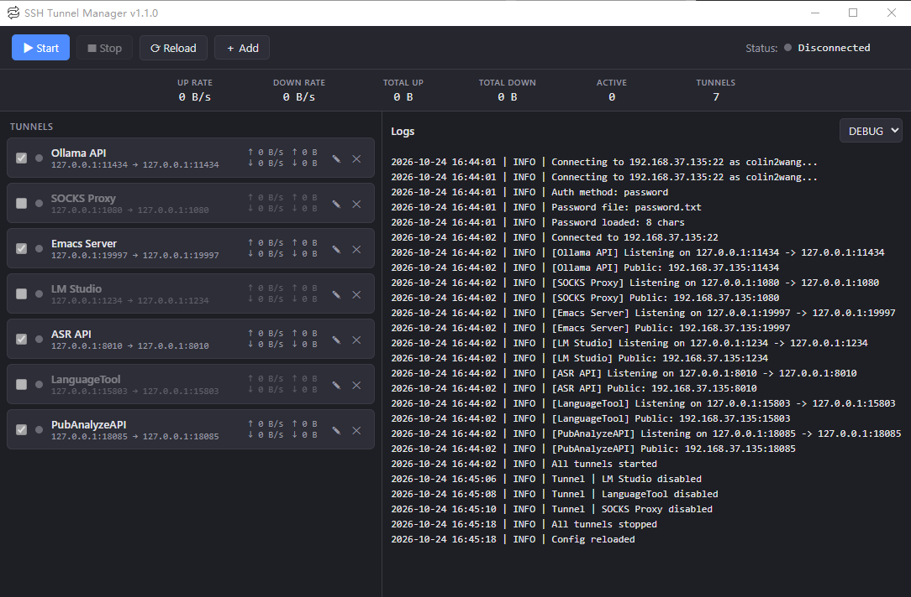
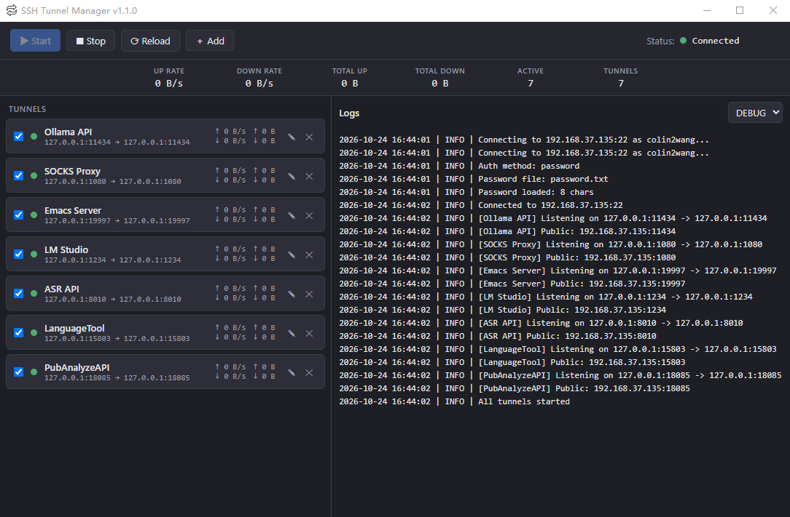

# SSH 隧道管理器

基于 **Wails v2 + Vue 3 + TypeScript**（Go 后端）的图形化 SSH 隧道管理器。集中管理多条 SSH 端口转发规则，实时监控流量与结构化日志。优先支持 Windows。

English | **[简体中文](README.zh-CN.md)**

## 功能特性

- **多隧道管理** - 同时运行多条 SSH 端口转发
- **单条隧道控制** - 通过复选框单独启用/禁用每条隧道
- **实时流量监控** - 每条隧道的上/下行速率、累计流量、活动隧道数
- **自动重连** - Keepalive 保活机制，掉线自动重连
- **灵活的认证方式** - 密码文件或 SSH 密钥（支持密钥口令）
- **YAML 配置** - `config.yaml` 易于编辑，界面内一键热重载
- **结构化日志** - 按级别过滤（DEBUG/INFO/WARN/ERROR），并持久化到 `logs/ssh-tunnel-YYYY-MM-DD.log`

## 界面截图



*未连接状态 —— 隧道已配置但未启动。*



*已连接状态 —— 所有已启用的隧道正在运行并监听。*

主界面包括：
- **工具栏** - Start（启动）、Stop（停止）、Reload Config（重载配置）、Add Tunnel（添加隧道）
- **统计卡片** - UP RATE（上行速率）、DOWN RATE（下行速率）、TOTAL UP（累计上行）、TOTAL DOWN（累计下行）、ACTIVE（活动数）、TUNNELS（隧道总数）
- **隧道列表** - 每条隧道显示复选框、名称、端口映射、状态与实时流量
- **日志面板** - 带时间戳、级别和消息的结构化日志，可按级别过滤
- **状态栏** - 当前连接状态（Disconnected / Connected）

## 环境要求

- [Go](https://go.dev/)（1.21+）
- [Node.js](https://nodejs.org/)（LTS）与 [pnpm](https://pnpm.io/)（`npm install -g pnpm`）
- [Wails CLI](https://wails.io/docs/gettingstarted/installation)（`go install github.com/wailsapp/wails/v2/cmd/wails@latest`）

## 构建

### 开发模式

```bash
wails dev
```

前端热重载运行。

### 发布构建

```powershell
.\build.ps1 -Version "1.1.0"
```

需要环境中有 `pnpm`。产物位于 `build\bin\`：

```
build\bin\
├── ssh-tunnel.exe    # 应用程序
├── config.yaml       # 配置文件（多次构建间保留）
└── password.txt      # SSH 密码（需自行编辑）
```

> `build.ps1` 不会覆盖已存在的 `config.yaml` / `password.txt`，重新构建不会丢失你的配置。

### 测试

```bash
go test ./...
```

## 使用说明

1. 编辑 exe 同目录下的 `config.yaml`，配置 SSH 服务器与隧道
2. 将 SSH 密码写入 `password.txt`（或配置密钥认证）
3. 运行 `ssh-tunnel.exe`
4. 点击工具栏 **Start** 连接服务器并启动所有已启用的隧道

### 命令行参数

```
ssh-tunnel.exe [options]

Options:
  -config string    配置文件路径（默认 "config.yaml"）
  -version          显示版本信息
```

### 运行时文件

| 路径 | 用途 |
| --- | --- |
| `config.yaml` | SSH 服务器与隧道配置 |
| `password.txt` | SSH 密码（明文，注意保密） |
| `logs/ssh-tunnel-YYYY-MM-DD.log` | 按天切割的运行日志 |
| `secrets/` | 密码/密钥口令的临时文件（用完即删，0700 权限） |

## 配置说明

编辑 `config.yaml`（参考 `configs/config-example.yaml`）：

```yaml
ssh:
  host: "your-server.com"
  port: 22
  user: "your-username"
  auth:
    method: "password"           # "password" 或 "key"
    password_file: "password.txt"
    key_file: "~/.ssh/id_rsa"
    key_passphrase_file: ""

tunnels:
  - name: "MySQL"
    local_port: 3306
    remote_host: "127.0.0.1"
    remote_port: 3306

  - name: "Redis"
    local_port: 6379
    remote_host: "127.0.0.1"
    remote_port: 6379

options:
  server_alive_interval: 15
  server_alive_count_max: 3
```

### 密码认证

将 `auth.method` 设为 `"password"`，并把 SSH 密码写入 `password_file` 指定的文件（默认 `password.txt`）。

### 密钥认证

```yaml
auth:
  method: "key"
  key_file: "~/.ssh/id_rsa"
  key_passphrase_file: ""  # 密钥无口令时留空
```

### 添加隧道

- **界面操作**：点击工具栏 **Add Tunnel**
- **文件操作**：直接编辑 `config.yaml`，然后点击 **Reload Config**

## 界面操作说明

### 工具栏

- **Start** - 连接 SSH 服务器并启动所有已启用的隧道
- **Stop** - 断开连接并停止所有隧道
- **Reload Config** - 重新加载 `config.yaml` 并重置连接
- **Add Tunnel** - 新增一条隧道

### 隧道列表

每条隧道显示：
- 复选框：单独启用/禁用该隧道
- 隧道名称与端口映射（`本地 -> 远程`）
- 状态指示（灰色 = 已禁用/未连接，绿色 = 已连接，红色 = 错误）
- 实时流量：`↑ 速率 (累计) | ↓ 速率 (累计)`

### 日志面板

- 按级别过滤日志（DEBUG、INFO、WARN、ERROR）
- 自动滚动到最新条目
- 格式：`YYYY-MM-DD HH:MM:SS | LEVEL | Message`

## 项目结构

```
go-ssh-tunnel/
├── main.go               # Wails 入口
├── internal/
│   ├── app/              # Wails 绑定层（前端 API 与事件推送）
│   ├── tunnel/           # SSH 连接与转发逻辑
│   └── config/           # YAML 配置读写
├── frontend/             # Vue 3 + Vite + TypeScript 界面
├── configs/              # 示例配置
├── docs/images/          # 截图
└── build.ps1             # 发布构建脚本
```

## 许可证

MIT License
